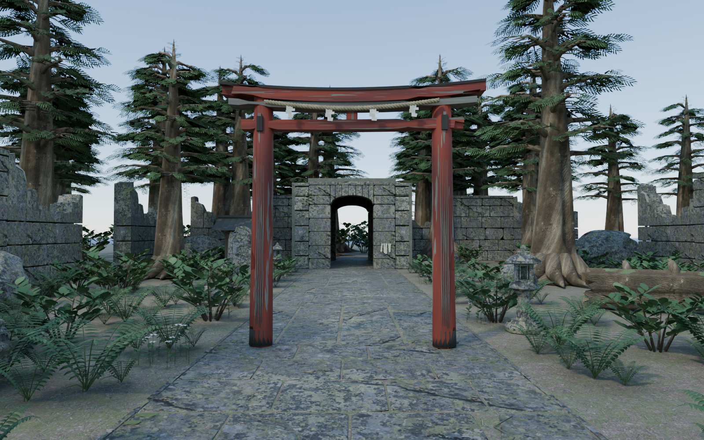
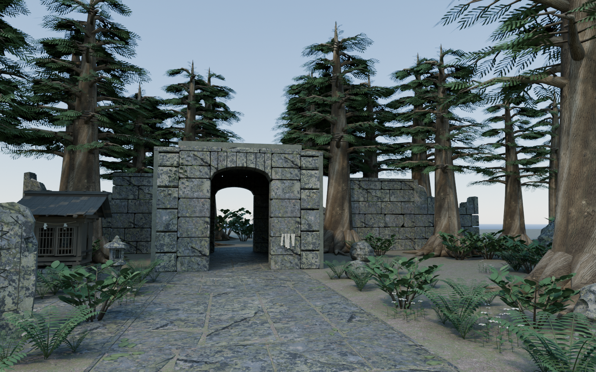
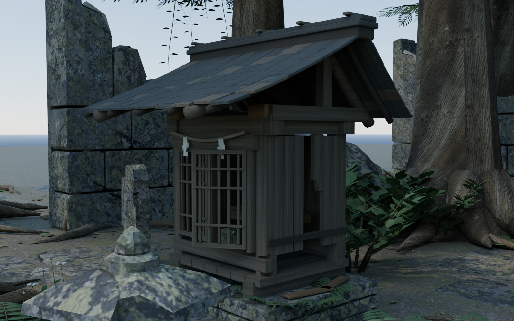

# 鎮守の根庭 — 一層後半の制作候補

根の参道から退色した鳥居を抜け、古木と小祠のある開放中庭へ進み、
石碑・紙札が残る地下封印回廊へ入る空間です。既存の「はじまりの樹海」
後半へ向けた候補で、ゲーム本体への配置は承認待ちです。

## 見る

- [個別アセット一覧・実測値](ASSET_LIST.md)
- [制作前構造設計](../../../../docs/3d/F1_SACRED_FOREST_PRODUCTION_DESIGN_20261116.md)
- [配置図](../../../../docs/3d/f1-sacred-forest-layout.svg)
- [Pinterest調査と公式作品資料](../../../../docs/3d/F1_SACRED_FOREST_REFERENCE_RESEARCH.md)
- [一つずつ行った実画像QA](../../../../docs/3d/F1_SACRED_FOREST_ASSET_REVIEW.md)







全景は個別に完成したGLBの配置からレンダリングします。コンセプト画像を
完成した3Dの証拠として使っていません。鳥瞰図は構造の確認用です。

## 検証済みの成果と範囲

- 個別アセット17点、GLB合計21,305,008 bytes / 136,665 triangles。
- 各GLBをBlenderで再読込した4方向PNG、計68枚。
- 個別GLBを用いた全景349配置（背景支持面1件を含む）。主要部24×32mと外周装飾を持ちます。
- 個別17点＋全景1点の計18 GLBをKhronos Validatorで検査し、errors 0 / warnings 0。
- Three.js r180の実GLB読込、床2×2接続、公式MCP経由の全景再読込を確認。
- 全景ブラウザ計測は4,432,376 triangles / 1,475 draw calls。これは完成候補の確認用密度で、ゲームの描画予算を達成したとの判定ではありません。

全景撮影はentry / courtyard / corridor / shrine_detail / birdseyeの5視点、
Cycles CPU・1600×1000px・48 samplesを使用します。各画像の完了記録とhashは
`scene/assembly-layout.json`と`manifest.json`を参照してください。

ゲーム未統合の静的素材です。実機FPSは未検証で、ユーザーの品質承認も未取得です。

## データ

- `modules/`, `props/`: 1素材1GLB、画像PBRを埋め込み。
- `sources/`: 画像をパックした編集用blend。Blender 5.3で保存。
- `renders/<asset>/`: 実GLB再読込から撮影した正面・側面・斜め・真上。
- `scene/scene.blend`: 個別GLBを組み立てた編集用空間。
- `scene/sacred_forest_scene.glb`: 組み立て空間の交換用データ。
- `scene/assembly-layout.json`: 配置・カメラ・出典GLBのhash・全景撮影記録。
- `scene/game-layout-candidate.json`: 既存一層3Fへ対応させた未適用の配置候補。
- `manifest.json`: 寸法、容量、三角形、材質、source commit、依存コードのhash、確認画像のhash。
- `verification/`: 形式検査、Three.js実読込、MCPによるシーン再読込の結果。
- `textures/`: CC0写真PBRの原本派生、色調派生、出典と変換記録。

単位はメートル。GLBは+Yが上、+Zが正面。4mセル、目高1.6mを基準とします。
床は上面中央、通常小物は接地部中央、垂れつるは取付上端が原点です。
細い葉先や苔の接地差は各bboxとレビューを参照してください。

## 実GLBをブラウザで回す

リポジトリのルートでHTTPサーバーを起動し、`preview/f1-sacred-forest.html`
を開きます。個別選択、回転、拡大、光の切替、床2×2接続比較、全景表示、
GLBダウンロードを利用できます。Three.js r180は既存方式と同じCDNから読みます。

```sh
python -m http.server 8791
```

## 一アセットずつ再制作する

Blender 5.3から`tools/f1-sacred-forest/assets/build_<id>.py`を一つずつ実行します。
生成後はGLBを再importして4方向撮影し、実画像を確認してから次へ進めます。
例（実行ファイルの場所は環境に合わせる）:

```sh
F1_RENDER_RES=640 F1_RENDER_SAMPLES=16 blender -b -t 4 --python tools/f1-sacred-forest/assets/build_weathered_torii_gate.py
blender -b --python tools/f1-sacred-forest/pack_sources.py -- --asset weathered_torii_gate
```

個別GLBが揃ったら組み立て、名前を指定して全景を撮影できます。

```sh
blender -b --python tools/f1-sacred-forest/assemble_scene.py -- --build --export-glb
blender -b --python tools/f1-sacred-forest/assemble_scene.py -- --render-view courtyard --width 1600 --height 1000 --samples 48
blender -b --python tools/f1-sacred-forest/pack_sources.py
python tools/f1-sacred-forest/collect_manifest.py
```

形式検査はKhronos glTF-Validator、描画検査はThree.jsのGLTFLoaderを使用します。
診断用npm依存は作業領域へ分離しており、ゲームの依存関係へ追加していません。
`BROWSER_MODULES`で診断パッケージの保存先を指定できます。

Blenderは画像を遅延読込します。初回保存だけで画像内蔵を断定せず、
`pack_sources.py`で明示的に内蔵し、存在しない相対参照先へ切替えて開き直し、
画像のデコードと形状不変を検査します。納品ソースはこの処理後のファイルです。

## 公式MCPで開き直す

公式Blender LabのアドオンとMCPサーバーは別途インストールします。
アドオンのコピーをこの候補データへ同梱していません。
`start_mcp_bridge.py`でlocalhost限定の公式ブリッジを起動し、公式serverが
使えるPython環境で`mcp_inspect_scene.py`を実行すると、実際のMCP経由で
全景blendを開いてバージョン・アセット・カメラを取得できます。

## 利用上の確認点

承認状態は`pending_user_review`です。新しい素材を既存ゲームへ適用しておらず、
前半・map・FOE・宝箱・セーブの固定IDを変更していません。
写真PBRと曲面の密度を保つため、1MB目安を超える複合部品は一覧へ明記します。
全景GLB・blend・確認画像の容量は、個別GLBの階層予算とは別です。

ブラウザ検証に用いるSwiftShaderの結果を、実機GPUや携帯端末のFPS保証と
扱いません。ゲーム側の距離カリング・共有インスタンス・品質設定と合わせて
配置密度を評価してください。風アニメーション、草の接触反応、粒子VFXは
今回の静的モデル完成と分けて扱います。

[出典・権利](CREDITS.md) / [統合担当への引き継ぎ](../../../../docs/3d/F1_SACRED_FOREST_CLAUDE_HANDOFF.md)
