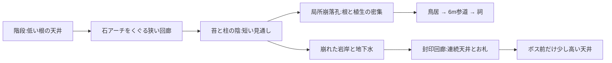

# 制作前・採用方向と確認用構造図

2026-11-17 JST。Pinterest新規32候補を調査担当が実画像確認、制作責任者は20枚contactを実確認。原画像を再配布・texture転用しない。個別部品監査、旧閉鎖回廊の実画像、水設計も確認してから制作へ進む。

| 観察した公開資料 | 翻訳する設計 |
| --- | --- |
| https://www.pinterest.com/pin/17592254793828502/ | 連続石天井を主にし、局所崩落孔だけ外光。全面の空はなし |
| https://www.pinterest.com/pin/38632509296728990/ | 柱と壁と頭上の根を連続させる |
| https://www.pinterest.com/pin/1122381538407308579/ | 支持柱・アーチの反復で短い見通し |
| https://www.pinterest.com/pin/860680178830275106/ | 鳥居から参道と祠を同軸に結ぶ |
| https://www.pinterest.com/pin/844284261439509382/ | 岸の石・水中石・堆積を立体で連続させる |
| https://www.pinterest.com/pin/957577939523347036/ | 苔の面が石目地や床モジュール境界を横断する |

Pinterestに架空/AI表現の候補もあるため実構造の正解と断定しない。ゲーム参照はブレワイの大小密度と探索導線、原神の素材/植生のまとまり、エンドフィールドの侵食と建築の対比を観察軸とする。ゲーム資産の複製なし。

断面: 歩行面0m → 目線1.6m → アーチ下面約2.9〜3.2m → 石天井4m付近。根は歩行線の頭上2.2m以上。柱や根元は既存非歩行#側に厚く寄せる。穴以外の天井は連続し、霧と暗い背景で未制作遠景を露出しない。目安far40m/fog0.045、明るさは実ゲームで調整し真っ暗にしない。

祠はworld[52,0,12]で東向き、鳥居は[58,0,12]で同じ参道軸、拝礼は既存歩行(14,3)。旧入口鳥居は移設し、入口ではアーチ/根/柱の通り抜け体験を作る。map/固定identity/水11/イベント機能は保持。

個別制作順: 1 不定形苔cap、2 低負荷下草、3 根巻き崩落石、4 頭上根、5 崩落孔縁、6 侵食岩岸。各1assetずつ生成→GLB再import4方向実撮影→目視→保存してから次へ。既存17GLBは上書きしない。

素材は既存Poly Haven CC0石/土/樹皮（元出典receipt保持）を再利用。土画像の緑色調派生は新しい苔写真scanとは呼ばず、派生式とhashを記録。植生を増やすため既存33,804triシダを大量複製せず、小型の専用株を作る。
