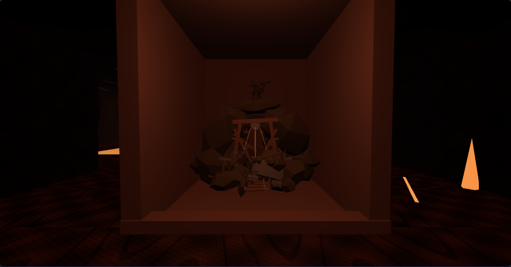
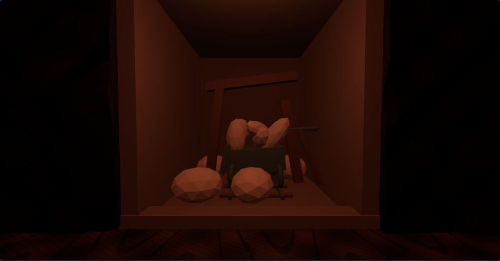
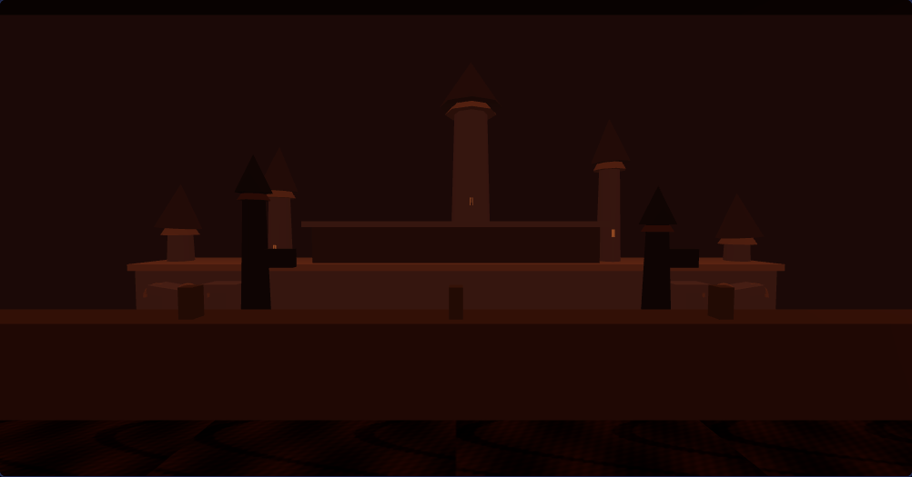

# 第4階層：素材のゲーム内配置と表示品質

対象：`development`。作業ブランチ：`feature/codex-b4-game-placement`。
参照：`docs/handoffs/B4_CODEX_PLACEMENT_2026-11-10.md`、`docs/art-direction/FLOOR4_DRAGONFIRE_3D_GUIDELINES.md`。

## 変更後の探索風景

各フロアに採掘設備1組、トロッコ付きの廃坑3組、城塞を望む展望窓1か所を配置。
通路と岩壁の境界を基準に、素材の+Zを通路側へ向け、底面と前面を合わせて均等縮尺で収める。
採掘跡は奥行3.25m・幅3.35m・高さ3.65m以内で、既存の壁セル内部に限定。
床・側壁・奥壁・天井・段差を追加して、浮遊や壁への埋没を防ぐ。通れる分岐にはしない。





画像は独立プレビューではなく、本編の探索カメラから取得したもの。検証結果と画像は後述の再現手順で生成できる。

## 配置と造形

- 対話・採集・階段・看板・壁操作・隠し通路などのセルと、その隣を候補から除外。
- 同じ壁セルが別の通路にも面する場合、そちらの壁を厚さ0.22mの平らな外皮にして、奥壁・側壁への食い込みを防ぐ。
- 採掘跡は5マス以上離し、同じ壁セルの二重使用を防ぐ。最大4組。
- 廃坑モデルは最初からサイトのローカル座標で生成し、再親子化に依存しない。レールを車輪の方向に合わせ、枕木を追加。
- 巨大岩・鉱石群は専用壁面レリーフに調整。高さ3.45m・幅2.65m以内、壁境界からの最大突出0.75m。採掘跡・展望窓の壁セルでは生成しない。最大20群。
- 城塞と尖塔は天井の裏へ隠さず、北端の連続した3枚の純粋な岩壁を、手すり付きの展望窓として描画。論理上は従来の壁のまま。遠景は48mのカメラ範囲に収まる位置と縮尺へ移動。
- 城塞の塔は高さ・位置を非対称にし、尖塔を傾け、石橋に大きな断裂と傾いた床版を設ける。
- 通路内にランダム配置されていた単独柱・細い床金属片と、3種の大型GLB環境オーバーレイの自動配置を、今回の配置方式で置き換えた。素材ファイルは削除していない。既存の竜・障壁のボス演出は継続。
- 第4階層の環境光を調整し、採掘跡の前に既存照明プール用の光源候補を4個追加。実際に描画する点光源プールの上限（低6・高14）は増やさない。

配置表の座標は0始まり。画面右の座標表示は+1。

| フロア | 採掘設備を正面に見る位置 | その他の廃坑を正面に見る位置 | 城塞を望む位置 |
|---|---|---|---|
| 10F / `4-0` | `(3,12)` 東 | `(23,8)` 東、`(19,1)` 南、`(10,5)` 北 | `(13,1)` 北 |
| 11F / `4-1` | `(3,12)` 東 | `(19,1)` 南、`(8,17)` 北、`(10,5)` 北 | `(13,1)` 北 |
| 12F / `4-2` | `(3,12)` 南 | `(2,9)` 北、`(25,13)` 北、`(21,6)` 東 | `(14,1)` 北 |

## 描画負荷と寿命

- 第4階層の基礎壁は16×14から8×8の分割へ変更。大きな岩盤の変形・専用岩モデル・既存の岩テクスチャは保持し、他階層の壁分割数は変えない。
- 採掘設備・トロッコ・岩/鉱石は、形状と材質ごとのInstancedMeshにまとめる。親子の変換をワールド行列へ反映してからまとめ、入れ子のトロッコ等がずれないようにする。インスタンスの境界球・境界箱を算出してカリングする。
- 所有する素材のサブツリーを限定して、ジオメトリ・材質・テクスチャ・ImageBitmap・インスタンスバッファを破棄。素材側のコールバックを重ねて呼ばない。
- テーマ内部の再構築では基礎資源を再利用し、テーマ切り替え時には第4階層の基礎ジオメトリとCanvasTextureも解放する。非同期で読み込み終わった旧B4モデルは新しいシーンへ追加せず破棄する。
- 往復検査で既存のFOEの足元リングの残留を検出。B4の表示を片付ける際にリングのジオメトリと個別材質を解放する。キャッシュ中の画像とThree.jsの共有Sprite形状は解放しない。FOEのAI・接触・ターン処理は変更しない。

## 保護範囲と統合上の注意

`data/field-maps.js`、FOEロジック、イベント、戦闘、セーブ処理は変更しない。第5階層の配置分岐・素材・環境設定も変更しない。
第5階層の壁のスイッチ・碑文の描画エントリは維持する。

既存のボス門の竜と障壁はBセル上に表示されるため、通常カメラ範囲のはみ出し検査からBセルそのものだけを除外する。ボス前の隣接セルは検査対象。

並行PR #164 / #167 / #172 / #174 / #178 が同じ共有描画モジュールを変更する可能性がある。取り込み時は第4階層分岐と今回の配置予約・破棄処理を保持して統合すること。
`main`への反映やPRのマージは実施しない。

## 再現手順

`three@0.180.0`、Playwright、Chromiumを検証環境に用意する。ゲーム側へ依存ライブラリは追加していない。

```sh
THREE_DIR=/path/to/three \
PLAYWRIGHT=/path/to/playwright \
CHROME=/usr/bin/chromium \
node tools/b4-3d/game-test.cjs /tmp/b4-checks
```

`QUALITY=high`で高画質、`MOBILE=1`で390×844のタッチ端末相当の表示を検証。
`GAME_ROOT=/path/to/unchanged-checkout`で同じテストを変更前へ実行できる。
ブラウザは毎回独立プロファイルを作り、利用者のセーブへアクセスしない。

## 確認結果（2026-11-10）

Chromium 156 / Three.js r180 / SwiftShaderで実施。

**確認済み**

- 第4・第5階層の各3フロアの起動・描画、B4の全採掘跡と展望窓の撮影。B4の通常のカメラ範囲への素材のはみ出しなし。
- 採掘跡・展望窓への前進は従来どおり壁で止まり、ターンは進まない。通常通路の前進では1歩・1ターンとなり、FOEが保持される。
- 第4階層の隠し通路は閉状態では通れず、既存の仕掛けフラグを立てると通れる。再構築後も壁の刻み書きの描画エントリが存在する。第5階層の壁操作エントリも保持。
- フィールドの保存→読込→保存の内容一致、現行saveVersion 12の維持、採集等の新項目を持たない旧形式データの読込。
- B4テーマの変更前の資源へdisposeイベントを登録し、全て1回ずつ解放されることを確認。共用ゲーム素材のジオメトリは解放されない。
- 高画質1280×800・低画質1280×800・タッチ端末相当390×844で、上記の機能と往復時の資源数の安定を検証。第1階層への復帰も確認。
- ウォームアップ後にB4の別フロアと0番フロアを3往復し、GPUジオメトリ・テクスチャ数が毎回一定になることを確認。
- 第5階層は変更前後で全3フロアのメッシュ数・インスタンス数・描画三角形数・操作対象の構成が一致。固定時刻で撮影した低画質の各入口の画像も比較。
- JS構文検査と`git diff --check`通過。

**負荷の比較**

B4 `4-0`の展望窓位置 `(13,1)` 北向き、低画質で比較。背景が見えるようになった分の描画も含む。
| 指標 | 変更前 | 最終版 |
|---|---:|---:|
| シーン内Mesh数（インスタンスは1オブジェクトとして計数） | 739 | 146 |
| 描画三角形数 | 653,880 | 292,154 |
| 描画呼出数 | 9 | 33 |

素材と遠景を追加しながら描画三角形を約55.3%削減。変更前は壁で城塞が見えないため、描画呼出数の単純比較をFPS改善率としては扱わない。

最終版の低画質でのGPU資源は、ウォームアップ後の3往復でジオメトリ81・テクスチャ123のまま一定。
壁分割削減前の高画質でも81/136、タッチ端末相当でも57/67で一定になった。最終版では壁分割削減と接合面の薄い外皮を含めて低画質の全検証を再実行した。

最終版と変更前のB5入口画像の差分画素数は、各フロア0 / 0 / 0（各1002×525画素）。

**未確認・制限**

- SwiftShaderの結果はスマートフォン実機のFPS保証には使わない。実機iPhone/Androidでの連続探索・発熱・FPSは未確認。
- 実際のボス戦の通しプレイは未実施。既存のボス門のBセル上には竜・障壁が表示される既存の仕様を保持。
- 検証環境では既存のGoogle Fontsに証明書エラーが発生した。Three.jsは正規の同一バージョンをローカル配信して検証。BGM/効果音の聴取テストは実施していない。
- 関連する未マージPRとの将来の統合・ユーザーの実際の保存データの読込は未実施。独立プロファイル内のテスト用データだけで確認。


## PR #206統合後の競合解消

マージ直前にdevelopmentへ第5階層のPR #206（`03df831`）が入り、共有描画・読み込み・キャッシュ番号の3ファイルが競合したため、両方の変更を保持して統合した。

- B4の採掘跡・展望窓・岩盤の配置予約と薄い接合面を保持。
- B5の廃墟・大聖堂の装飾、天井/壁、描画距離180m、視界内FOE表示、シーンの再利用、非同期の階層切り替え処理を保持。
- disposeの呼び出し形式をB5側の`{ final: true }`へ統一。B4の所有する素材を二重解放しないよう所有区分を統合。B4では従来どおりフロア変更時に基礎資源を解放し、B5では同階層内で再利用する。
- FOEのリングと専用材質の破棄は共通の片付け処理で1回実施。画像キャッシュとThree.js共有Sprite形状は維持する。
- B4の採掘設備・トロッコ・城塞の比較画像3枚は、競合解消前と画素単位で一致。

競合解消後、B4の全フロア・移動・壁操作・旧形式読込・所有資源の破棄・往復時の資源数のテストを再実行して通過。B5側の全フロア・4騎士の仕掛け・扉・サブイベント・セーブ往復・配置と破棄のテストも通過。
