# B4 火山洞窟：第1階層を基準にした表示品質の改善

基準：development / PR #205で配置した素材、`FLOOR4_DRAGONFIRE_3D_GUIDELINES.md`。
作業：`feature/codex-b4-visual-quality`。mainは変更しない。

## 第1階層から参考にした点

第1階層の本編画面で、石積みの立体的な厚み、床の凹凸、材質の細部、近景から奥まで形が読める明暗を確認。
第4階層では岩肌が黒く潰れ、溶岩の四角い平面が目立ち、採掘跡の形状と材質が読み取りにくかった。

世界観は火山岩洞窟・溶岩・鉱石・廃坑・ドラゴンのまま。第1階層の植生や緑色の苔、森の配色は移植しない。
「第1階層以上」の評価は主観を伴うため、本編の比較画像と検証結果を示して判断できる状態にする。

## 造形と画面構成

- 壁沿いに不均一な六角形の玄武岩柱、水平の断裂、岩棚、3本の焼けた爪痕を配置。採掘跡の縁も角張った岩の集積で覆い、単純な箱の輪郭を崩す。
- トロッコを板張りの荷台・金属の補強帯・車輪のスポークに分け、積載鉱石に結晶の束を加える。
- 城塞へ扶壁、アーチ付きの壁面、凹凸のある胸壁、細い発光窓、丸屋根、断裂した高架、吊り構造、火山島の岩盤と溶岩滝を追加。背景には灰煙と溶岩の照り返しを数式で描く。
- ボスフロアの広い洞窟だけ天井を8.1mへ高くし、壁の上部に岩棚を追加。採掘跡・展望窓の上部は岩で閉じ、隣室を覗ける隙間を作らない。
- 床に浅い凹凸を加える。天井パネルは縁を揃え、隣接パネル間の隙間をなくす。鍾乳石の向きを下向きへ直し、先端がカメラの高さへ届かない長さに制限する。
- 溶岩面の隙間を埋め、既存の溶岩画像を使った流動・発光・法線のアニメーション、岸辺の冷却岩、大小の岩殻、火の粉を追加。

## 材質・照明・負荷

- 既存のB4用PBR画像を実際の壁・床・採掘跡・城塞へ接続。元ファイルは保持する。木目のみオリジナルの手続き描画。
- 暗い岩の材質をさらに暗色で乗算していた状態を改め、法線・粗さと形状が読める色と環境光へ調整。
- カメラ付近の柔らかい補助光と溶岩の照り返しを、既存の点光源プール（低6・高14）に登録。点光源数の上限と共通露出値は変えない。B4だけ光源候補を毎フレーム更新する。
- 低画質では1024pxのPBR画像を実行時に512pxへ縮小し、該当画像のテクセルメモリを1/4に抑える。高画質は元画像を使う。
- 柱・岩・石積み・スポークは材質/形状ごとのインスタンスにまとめる。火の粉は1つのPointsで描画し、以前の個別Meshの更新を置き換える。
- 共用PBR材質とテクスチャはB4の材質ライブラリが所有し、各配置グループの破棄では二重解放しない。テーマの完全破棄時に一度だけ解放する。

## 保護範囲

マップデータ・通行判定・FOEのAI・仕掛け・戦闘・セーブ形式は変更しない。
新しい造形は通常のカメラ/FOEの中央領域を避け、既存のイベント・壁操作・隠し通路の周囲を除外する。
第1・第2・第3・第5階層の見た目と描画設定を変更しない。

関連PR #164 / #167 / #172 / #174 / #178 は別ブランチで未統合。今回、これらの形状目標に重なる部分は新しいB4専用モジュールへ集約した。後からそのまま重ねてマージせず、重複する柱・岸辺・天井・照明・岩殻を確認すること。

## 検証と比較画像

第1階層と、変更前後の第4階層の同じ探索位置を撮影して比較する。
第1階層の参考画面（本編・低画質）：

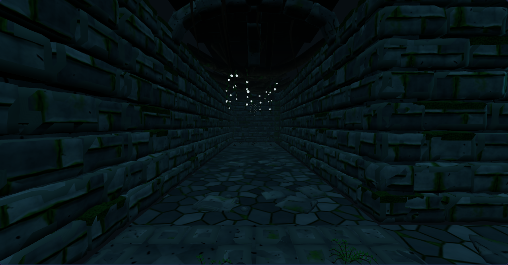

以下は全て本編の同じ探索位置・低画質・固定時刻の比較。プレビュー専用の別シーンではない。

| 変更前 | 改善後 |
|---|---|
| 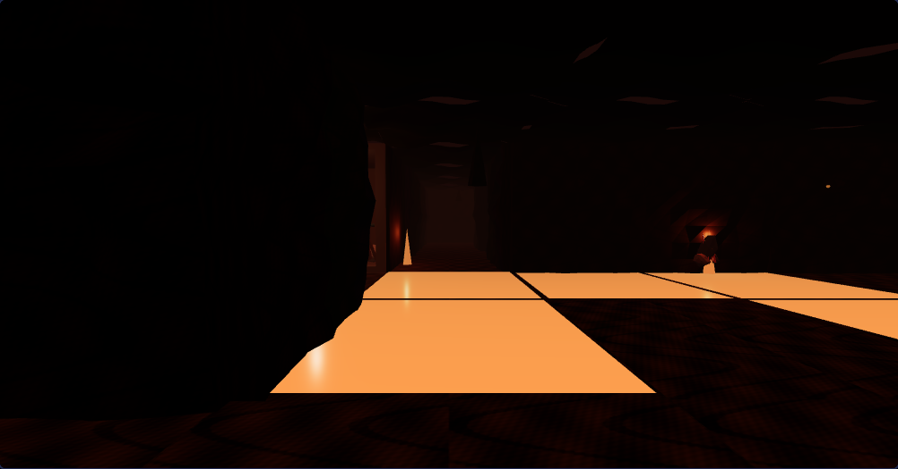 | 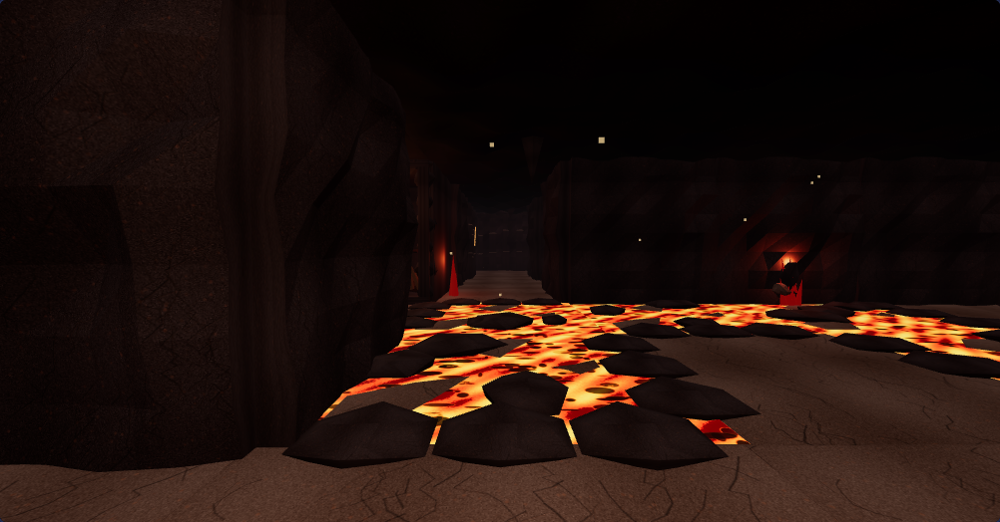 |
| 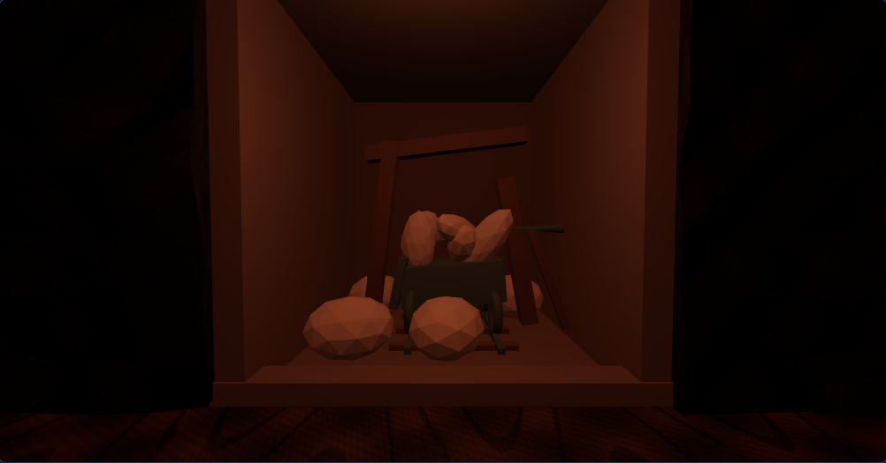 | 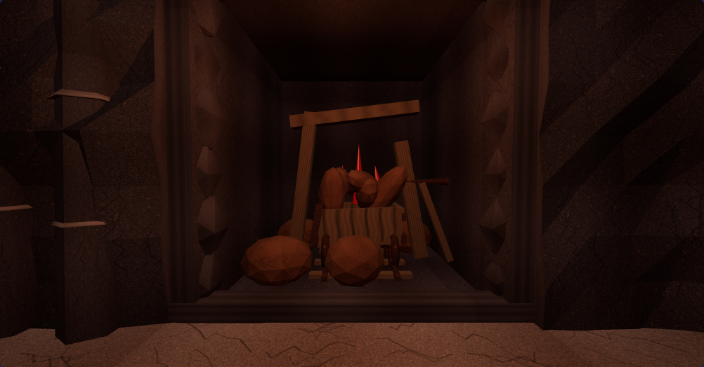 |
| 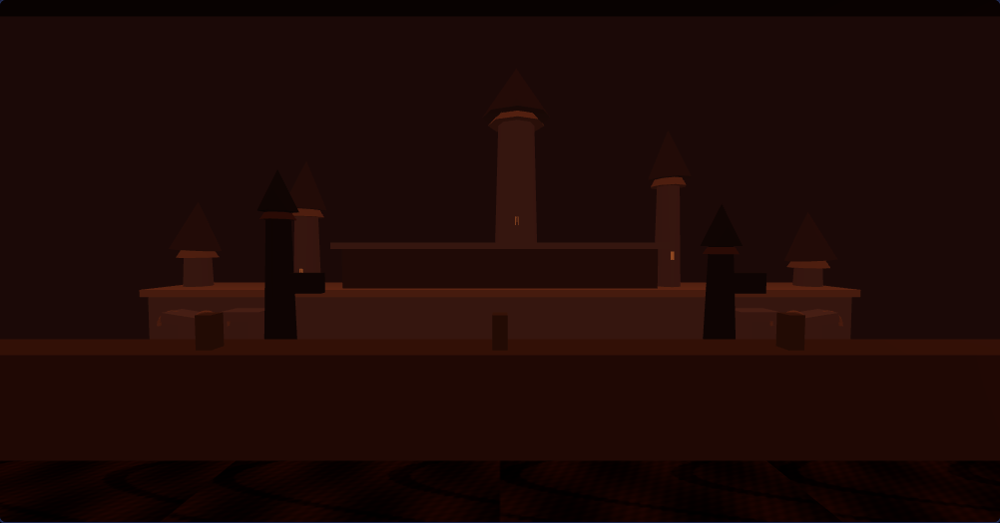 | 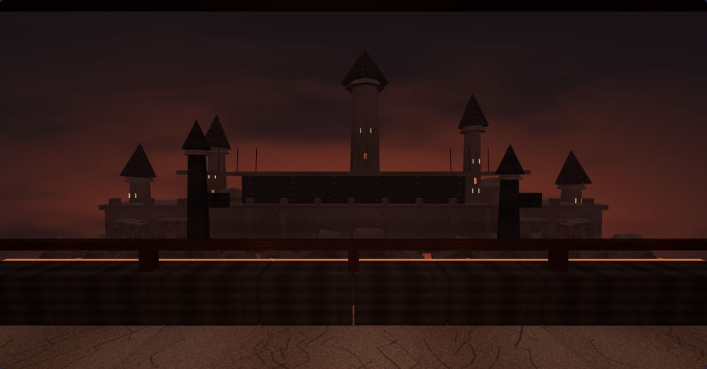 |
| 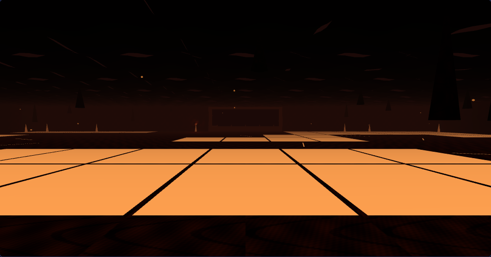 | 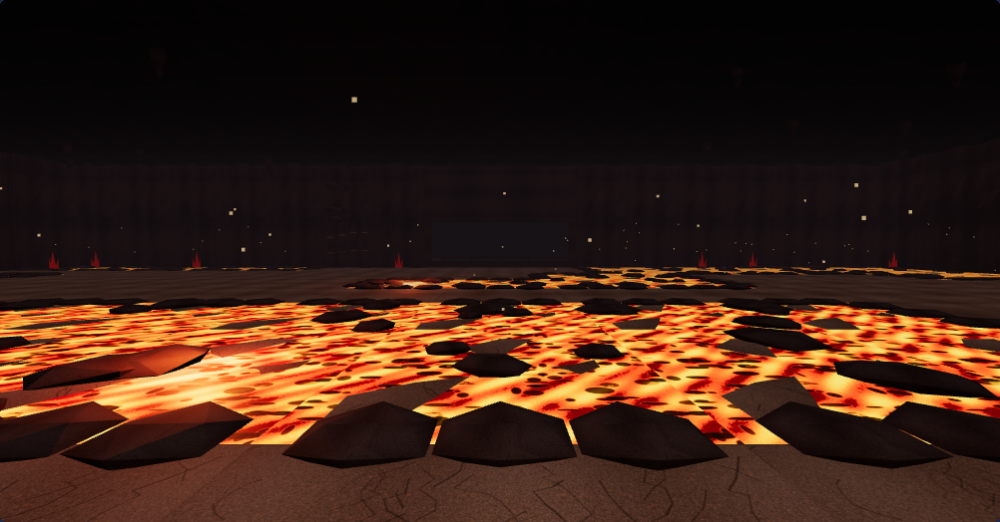 |

高画質の溶岩：

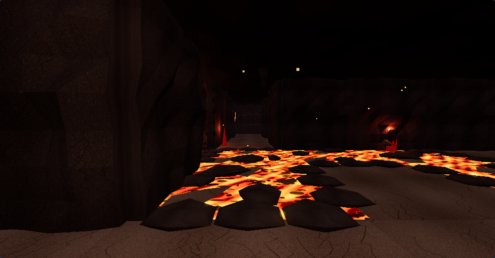

スマートフォン相当390×844・低画質の採掘跡：

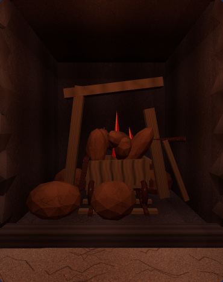

### 確認済み

- Chromium 156 / Three.js r180 / SwiftShader。低画質・高画質・タッチ端末相当の実際のゲーム画面を撮影。
- B4の全3フロアでカメラ領域へのはみ出しなし。採掘跡・展望窓へは従来どおり進めず、通常通路の移動とFOE・ターン処理は維持。
- 隠し通路の開閉、壁操作の描画対象、セーブの往復と旧形式データの読込を確認。saveVersion 12を維持。
- 所有する形状・材質の破棄イベントを監視し、1回だけ解放。共用ゲーム素材を破棄しないことを確認。
- ウォームアップ後にフロアを3往復し、GPU資源数が一定。PC低画質はジオメトリ87・テクスチャ136、タッチ端末相当は64・80で毎回一致。
- 実際に使用している材質で色・法線・粗さ画像の読込を確認。低画質は最大512px、高画質は最大1024px。点光源プールは低6・高14のまま。
- 溶岩のUVが進み、10秒/12秒の描画画像が変化することを確認。火の粉と発光の更新も同じ時刻で再現できる。
- B1とB5へ戻って描画できる。B5の入口は変更前と画素単位で一致。第1階層の描画経路・素材・環境設定は変更していない。
- JS構文検査と差分の空白検査を通過。

### 負荷

以下は同一位置・PC低画質での比較。造形・材質・背景の追加により三角形数は増えるため、全面的な軽量化や実機FPSの向上を示すものではない。

| 視点 | 描画呼出数 前→後 | 描画三角形数 前→後 |
|---|---:|---:|
| b4-minecart | 20 → 24 | 290,454 → 341,074 |
| b4-citadel | 33 → 40 | 292,154 → 345,504 |
| b4-lava | 45 → 46 | 294,366 → 347,576 |
| b4-chamber | 47 → 41 | 136,746 → 180,828 |

高画質の描画カウンターは、ポスト処理の最後の1枚だけでなく全パスを合計して記録する。
B4の原画像は削除・変更せず、低画質時だけ1024pxの画像を実行時に512pxへ縮小する。

### 再現

```sh
THREE_DIR=/path/to/three PLAYWRIGHT=/path/to/playwright CHROME=/usr/bin/chromium \
node tools/b4-3d/game-test.cjs /tmp/b4-gameplay

THREE_DIR=/path/to/three PLAYWRIGHT=/path/to/playwright CHROME=/usr/bin/chromium \
B4_ONLY=1 QUALITY=high node tools/b4-3d/visual-test.cjs /tmp/b4-visual
```

`MOBILE=1`で390×844のタッチ端末相当、`SCENE=b4-lava`で流動の画像差分だけを確認できる。
比較する旧チェックアウトは`GAME_ROOT`と`BASELINE=1`で指定する。
ブラウザは独立プロファイルを使い、利用者の保存データを開かず、自動保存を無効にする。

### 未確認

iPhone/Android実機のFPS・発熱・長時間連続探索、ボス戦の通しプレイと音声の聴取は未実施。
ソフトウェア描画のカウンターを実機FPSの保証には使わない。

