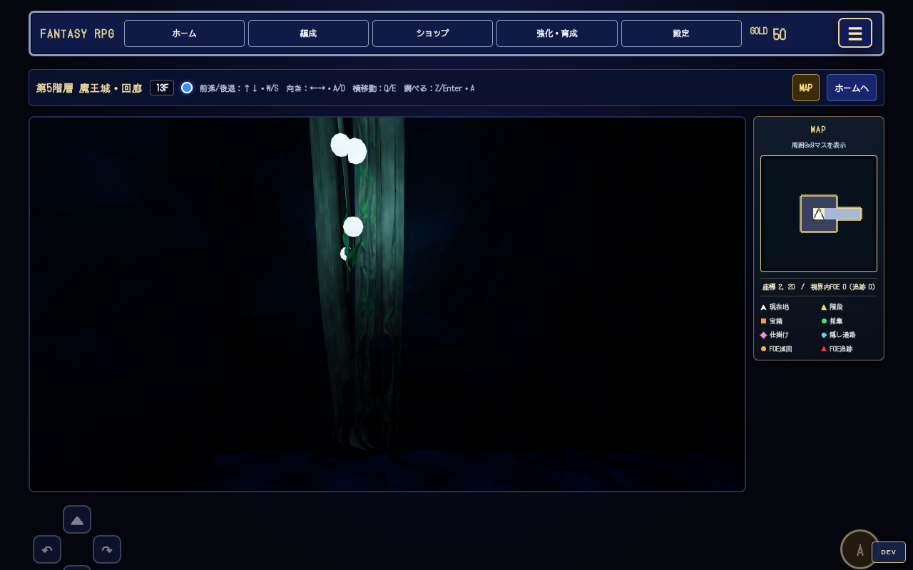
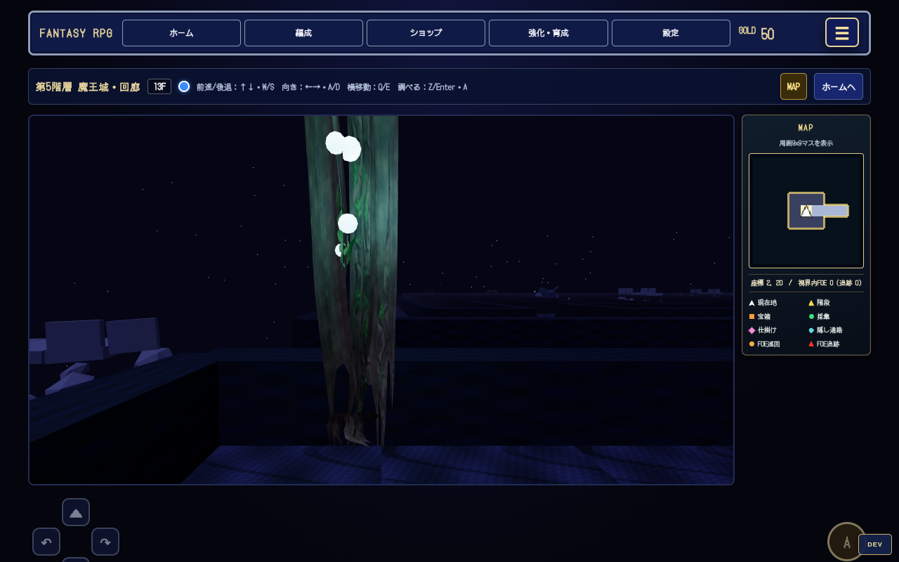
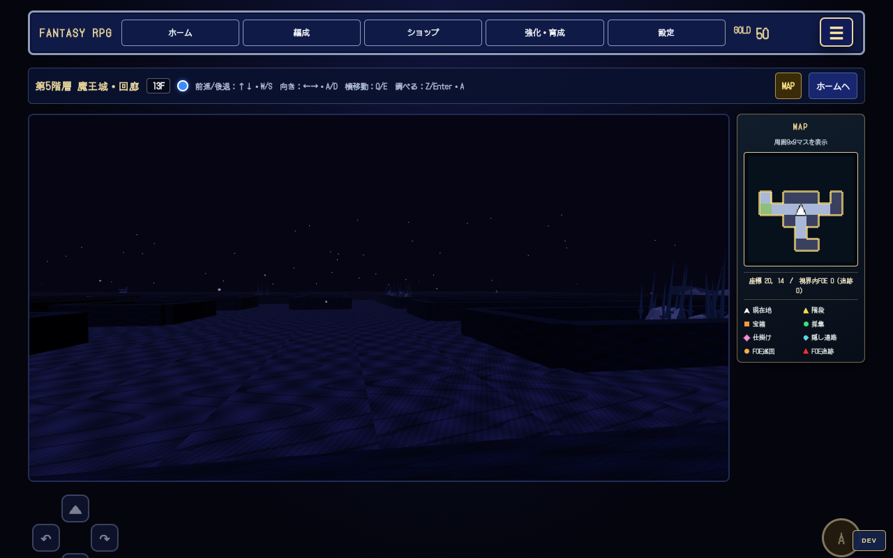
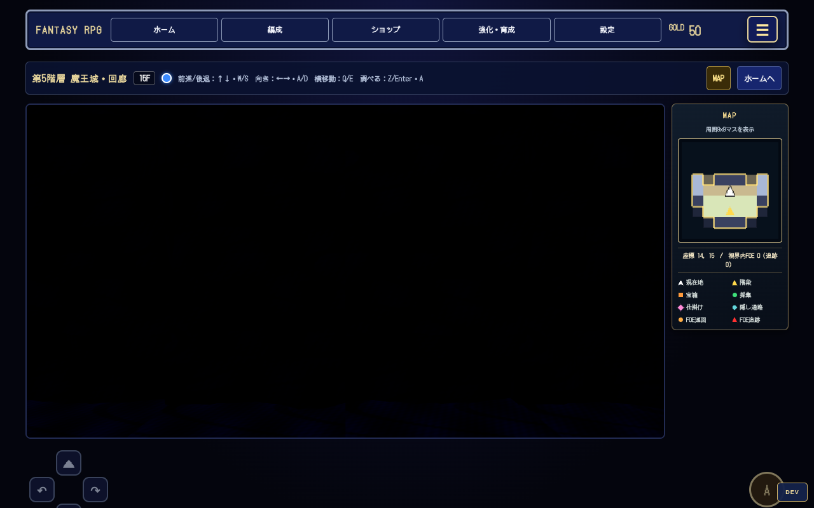
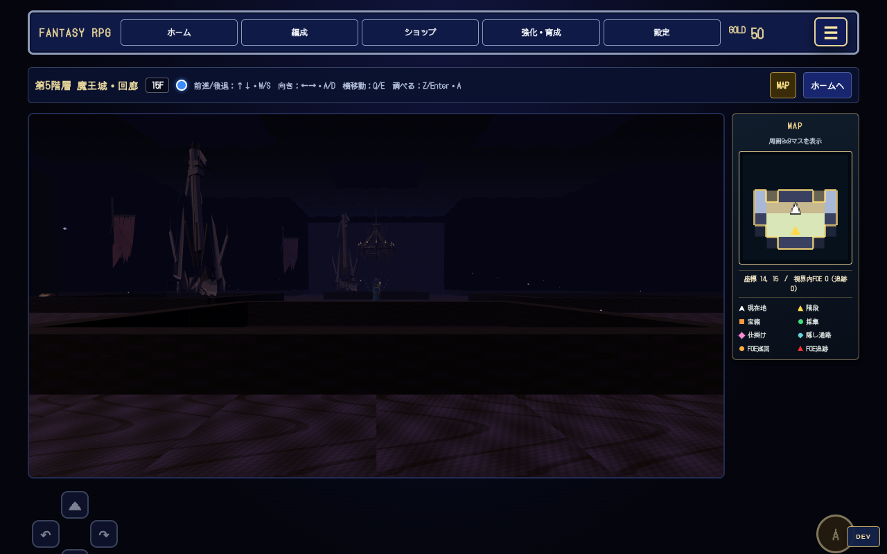
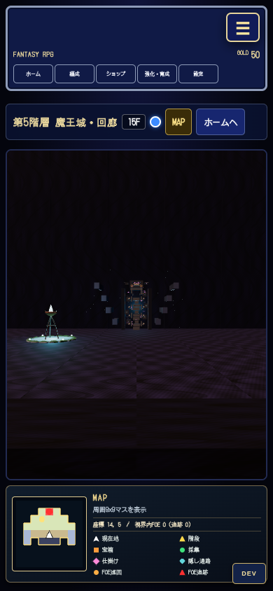
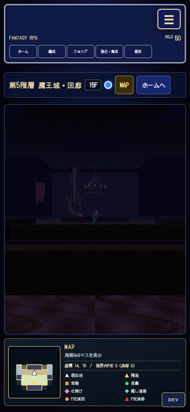

# 第5階層3D統合・ブラウザ検証

対象: `development` の `17f277f` から作成した `feature/ai-gpt-b5-3d-integration`。
引き継ぎ: `docs/handoffs/B5_CODEX_3D_INTEGRATION_2026-11-10.md`。

## 配置と既存機能

- 通常迷宮（B5の1F/2F、画面の13F/14F）: 剣群・破損兵器・崩落橋の3種。壁セル内に12組、マップ外に大型橋と兵器を各1組。奈落の星・浮遊岩盤・遠方遺跡は補助。
- 魔王の間（`B` ボスマーカーを持つB5フロア、画面の15F）: #201の破損柱・垂れ旗・シャンデリアの3種、計8組。#200と比較し、重複する柱/旗/シャンデリアを両キットから重ねて置かない。玉座GLBを維持。
- 通常迷宮は洞窟天井を描かず、壁を低い遺構として表示。魔王の間は16mの天井・外壁と11mの柱、9mの旗。内部壁は低くし、壁セル内の造形を隠さず、玉座へ向かう既存通路を見渡せるようにした。
- 小物は外形全体を3.25m四方に収め、オブジェクトとその周囲1マスを避ける。シャンデリアは床面から5.2m以上。新しい当たり判定は追加しない。
- 第5階層に限りFOEの描画を既存 `fieldState.visible` に合わせ、低い壁越しの情報漏れを防止。移動・巡回・追跡・戦闘のロジックは変更しない。
- マップ、固定ID、セーブ形式（現行12）、イベント、謎解き、UIのデータは変更しない。既存の壁スイッチ・碑文・保存点・NPC・イベント表示経路を維持。
- B5専用の補助光を追加。既存素材ファイル・材質・他階層の環境光設定は変更しない。

## 負荷とライフサイクル

静的造形は素材ごとにジオメトリを結合し、近隣の素材単位でカリング可能なまま描画回数を削減。特に既存玉座GLBの604メッシュを16材質のメッシュにまとめた。B5壁には洞窟用16×14分割の代わりに2×2分割を使用する。

同階層ではテーマの共有形状を再利用し、フロア切替時に小物・遠景・玉座モデル・InstancedMeshの資源を解放。階層を離れる時は共有形状・材質・生成テクスチャも解放する。FOEの共有画像はキャッシュに残し、フロア固有のスプライト材質・リング形状は破棄する。B1へ戻る際は破棄済みテーマを参照しない。非同期組立を直列化し、読み込み中のフロア変更で古いシーンを有効化しない。

## 検証方法

Chromium + Playwright、Three.js r180、SwiftShader（GPUなしのソフトウェア描画）、1280×800 / 390×844、低画質。新規ブラウザコンテキスト、テスト専用状態で実施。オートセーブとランダムエンカウントを無効化し、ユーザーの保存データは使わない。Three.jsは同バージョンのローカルパッケージへルーティング。既存Googleフォントはcurl経由で環境のCAを使いTLS検証して取得する（Chrome単体ではプロキシCAの信頼エラーがあった）。

再実行: `tools/b5-3d/README.md`。生の計測値・配置座標・解放数は隣接ディレクトリの `after-report.json`。

### 確認済み

- 実ゲームで全3フロアが3D表示。通常迷宮と魔王の間で別の素材を使用。デスクトップと縦長画面で撮影・目視確認。
- キーボードで1マス前進・旋回、FOEの生成。既存 `test_basic.js` で壁・扉・FOE巡回/追跡/衝突/撃破を確認。
- ブラウザ内で4騎士像の順番を実行→扉開放、折れた剣サブイベント完了。会話・選択肢のみ自動応答して実ロジックを実行。
- `fieldSerialize` → `fieldDeserialize` → `fieldSerialize` が一致。現行セーブ形式12を維持。
- 全歩行マスと各装飾の外形を照合し、床付近での重複なし。再生成の配置一致、マップデータ不変。
- 生成した装飾の全接続ジオメトリ・材質のdispose通知を確認。二重disposeは追加通知を発生させない。
- `node tools/world-tree/test_basic.js` / `test_puzzles.js` / `test_flee.js` と変更JSの構文検査、`git diff --check` はPASS。
- 最終ブラウザ検証のページ例外・コンソールエラー・リクエスト失敗は0件。

### 既存テストの失敗

`node tools/world-tree/loot_test.js` は59 PASS / 5 FAIL。同じ `17f277f` の未変更コードでも同じ59 PASS / 5 FAILを再現した。5件はセーブ形式11を期待する旧テストと、現行のセーブ形式12/移行処理の不一致。今回の3D統合でセーブ処理やテストの期待値は変更しない。

### 検証範囲の限界

ハードウェアGPU・実スマートフォン・高画質Bloomの性能、ボスを含む戦闘の全行動・全イベントの通し攻略は未確認。短いFPSサンプルはこのソフトウェア描画環境の参考値であり、実機の快適性を保証するものではない。

## 既存PRとの関係

開始時と提出前にdevelopmentおよびopen PRを確認。#160/#165/#168/#171/#173 は旧B5表現の変更、#193は未統合の遠景素材。今回は採用済みの素材を接続し、これらの未統合ブランチは変更しない。#162/#190（B3）、#203（B2）とは共有描画ファイル・読込バージョンの競合を統合時に再確認すること。`main` には反映しない。

## 比較計測（同じ位置・同じ画面サイズ）

8フレームのrAF間隔平均。draw call/三角形は測定位置での最終フレーム。表示範囲が拡大したため、draw callは総数の単純比較だけで評価しない。

| 場所 | FPS 変更前→後 | draw call 変更前→後 | 三角形 変更前→後 |
| --- | ---: | ---: | ---: |
| 通常迷宮1F | 0.50 → 1.78 | 24 → 96 | 658,396 → 55,451 |
| 通常迷宮2F | 0.67 → 2.10 | 33 → 125 | 666,033 → 51,086 |
| 魔王の間 | 0.84 → 1.53 | 38 → 70 | 194,689 → 89,229 |

魔王の間の変更前は低い壁と天井で造形が隠れる。変更後は空間と新素材が見えるためdraw callは増える一方、三角形数は減少。新素材を追加した直後の未最適化版では同位置658 callsだったが、玉座の結合後は70 calls。FPSはGPUなし環境でも改善したが、絶対値は低い。

## 比較画像

通常迷宮・変更前:

通常迷宮・変更後（入口と剣群）:

魔王の間・変更前:

魔王の間・変更後:

縦長画面（玉座側）:

## 階層切替の追加検証

640×480で B5通常→魔王の間→通常→魔王の間→通常→B1→B5→B4→B5 を順に表示し、さらに非同期組立中にB5の行先を変更した。すべて最新フロアの3D表示へ復帰し、rapid switchの完了判定もPASS。各切替後に2フレーム待ってカウンタを記録。B5を暖機した後の通常迷宮は67 geometries / 94 textures、魔王の間は75 / 94で、往復しても同値。B1/B4訪問後の共有素材キャッシュ増加は別途記録した。詳細は `b5-integration-20261110/lifecycle-report.json`。

最終の追加検証でも、ページ例外・コンソールエラー・通信失敗・通信キャンセルは0件。検証ツールはBGM切替による `net::ERR_ABORTED` を通常の通信キャンセルとしてエラーと分けて記録する（音声の再生処理は変更しない）。

同じ軸線からの縦長画面:

