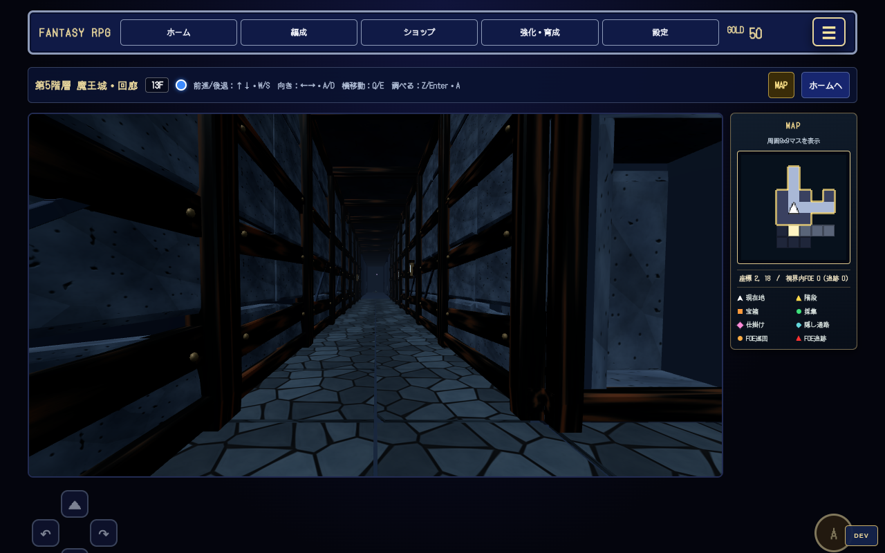
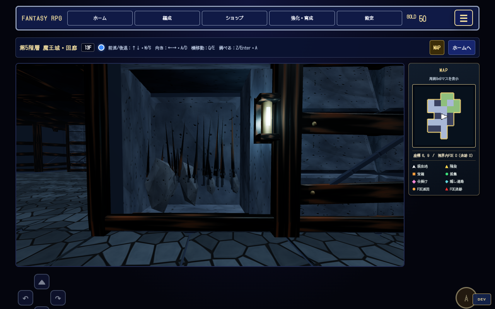
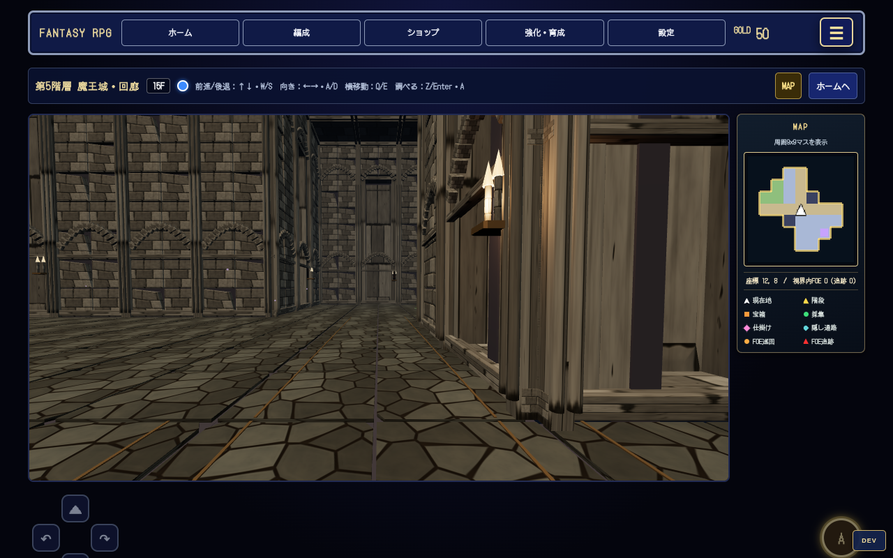
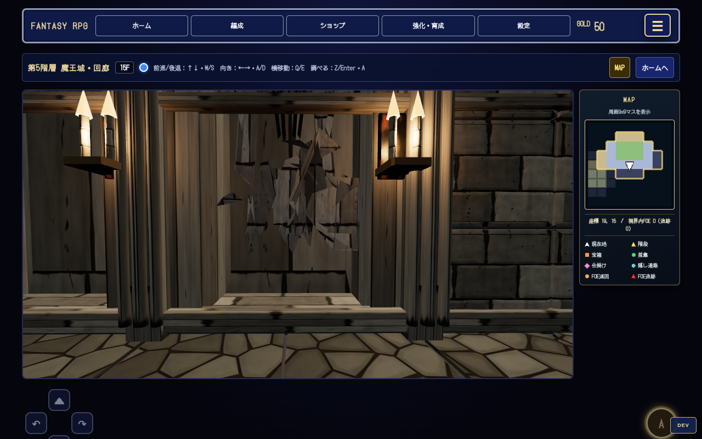
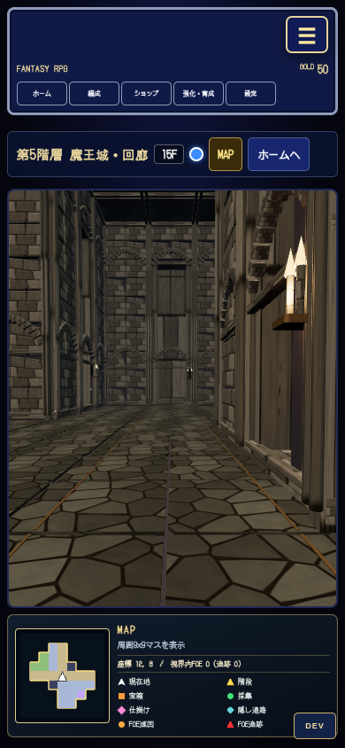
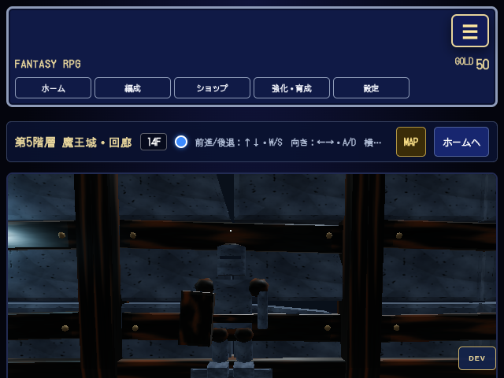
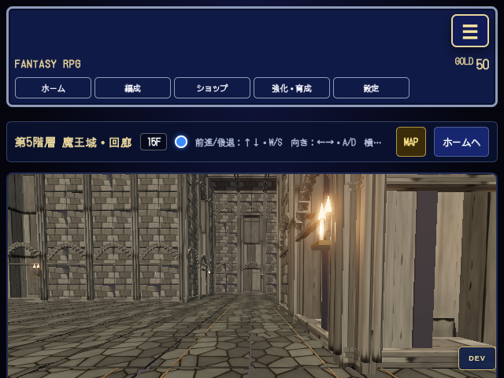
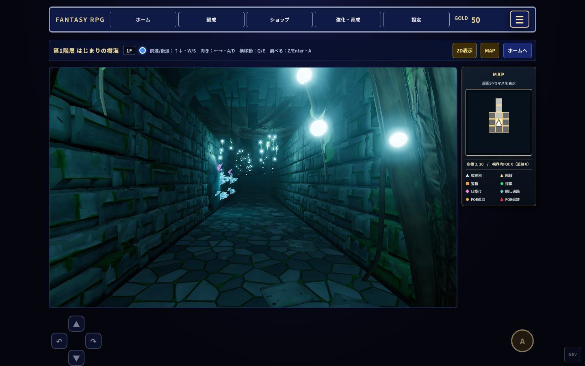
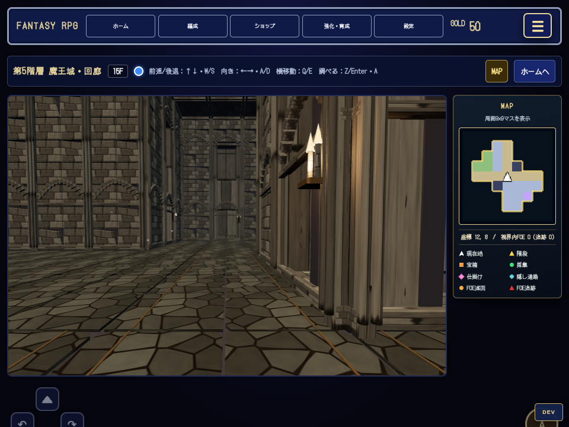

# 第5階層：壁の遮蔽復旧と描画品質の改善

対象: `feature/ai-gpt-b5-occlusion-quality` → `development`。元の統合PR #206では遠景表示を優先して壁を低くしていたが、ユーザーから「壁がないのはダメ、向こう側を見せない」と指摘されたため、低い壁を廃止した。

## 表示上の変更

- 通常迷宮は6.4m、魔王の間は16m。すべての壁面に、床下から天井まで連続する不透明な背板を置く。天井も閉じ、壁の継ぎ目・上部・装飾のくぼみから隣室を見せない。
- 通常迷宮: 欠けた玄武岩の外形、重ねた古代の装甲、金属の留め具、斜めの戦傷、頭上の破断梁、青白い遺構灯。剣・兵器・崩落橋・瓦礫は壁のくぼみに配置し、奥を塞ぐ。
- 魔王の間: 石積み、束ねた細柱、尖頭アーチ、コーニス、格天井、石造床の縁飾り、燭台、垂れ旗とシャンデリア。既存の玉座は維持。柱・旗も奥が塞がった壁面のくぼみに収める。
- 第1階層の `tools/b1-3d/lib/tex.js` と実画面を参照。B5専用の512px色・法線・ORMマップを15枚生成し、壁・床・鉄・旗に適用。苔や森の根は移植しない。小物の石材・金属にも同じ材質を適用し、平坦な単色との落差を減らした。
- 第5階層の出口を森の根のアーチから石・金属の門枠へ変更。位置を壁際へ寄せて視点を塞がない。出口のキー・遷移処理はそのまま。
- 4騎士像のスイッチは、剣・盾・杖・弓を持つ壁面彫刻として表示。既存のID・順番・扉の開放処理は変更せず、壁に埋もれない位置へ取り付けた。
- 高画質では既存Three.jsの反射環境を低い強度で使用。B5を離れると環境を復元・破棄し、他階層へ持ち出さない。

第1階層のアセット・生成器は変更していない。新規素材の由来と再生成方法は `ASSETS_CREDITS.md` と `tools/b5-3d/README.md`。

## 探索の維持と負荷対策

マップのセル、通行判定、FOEの行動、イベント、セーブ形式12は変更しない。見た目のくぼみには通行判定を追加しない。スイッチ・碑文・NPC・セーブ地点・階段・扉の表示／状態同期は既存経路を使用する。

細部は12m単位の空間チャンクと共有形状のInstancedMeshにまとめ、遠方の細部を省略する。**遮蔽用の背板・屋根・床本体は省略しない。** 低画質は近い実光源2個、高画質は6個。他階層へ戻ると元の6/14個へ復元する。GPU資源は生成側で所有し、形状・材質・テクスチャ・反射環境をフロア／階層切替時に破棄する。

## 検証条件と範囲

Chromium + Playwright + Three.js r180、SwiftShaderソフトウェア描画。新規のテスト専用ブラウザ状態で、ユーザーの保存データは使用しない。低画質1280×800、縦長390×844、高画質の切替確認は640×480。ゲームの会話・選択肢は一部自動応答する。

- 全3フロアの壁面を4つの高さ・3つの横位置から検査（計13,344本のレイ）。壁で遮られることを確認。
- 実際のジオメトリの後ろへマゼンタ色の面を置いて描画。透けた画素0。壁を非表示にした陽性対照では128×128=16,384画素が見え、検査が遮蔽を検出できることも確認。
- 装飾の外形と全歩行マスの重複なし、決定論的配置、マップ不変、生成資源のdisposeを検査。
- ブラウザ内の移動・旋回、FOE生成、4騎士像→扉開放、サブイベント、セーブ往復一致を確認。
- `test_basic.js` / `test_puzzles.js` / `test_flee.js`、変更JSの構文、差分の空白検査を実施。

ソフトウェア描画のFPSは実GPUの性能を表さない。実スマートフォンでの性能と全戦闘・全イベントの通し攻略は未確認。グラフィックが基準以上かの最終的な見た目の判断用に、ゲーム画面を添付する。

## 並行作業との区別

最新developmentの `07eb8c6` を取り込み、B3/B4統合と倒壊石柱のFRONT暫定承認メモを保持。本変更はゲーム内の壁・材質・配置の改善であり、未統合のDraft PR #210の `field/assets/b5-fallen-pillar.js` や承認済みFRONT形状には変更を加えていない。#210のBACK確認・モデル制作とは別の作業として扱う。`main` へは反映しない。

## 計測と実画面

低画質の参考計測は1280×800、8フレームのrAF間隔平均。壁・屋根・新しいPBRを描くため、旧「低い壁」の版より負荷は増える。これを隠さず、ソフトウェア描画の絶対値として記録する。細部チャンクと光源数を調整する前は約0.17〜0.24 FPSだった。以下は調整後の基本動作検証時の値（最終の小物・騎士像の材質調整前）。

| 場所 | draw calls | 三角形 | FPS（SwiftShader） |
| --- | ---: | ---: | ---: |
| 通常迷宮1F | 134 | 83,659 | 0.56 |
| 通常迷宮2F | 177 | 97,910 | 0.52 |
| 魔王の間 | 274 | 199,696 | 0.23 |

これはCPUで描く検証環境の数値であり、快適なFPSを確認したという意味ではない。物理GPUでの実測は未実施。比較基準のB1もこの環境では高負荷であり、B1の素材や描画品質を下げる変更は行っていない。最終の各視点のdraw/三角形・資源数は `quality-report.json`、操作検証は `functional-report.json`、高画質の環境復元は `high-report.json` に保存。高画質のdraw/三角形はポスト処理の最終パスの値になるため、シーンの負荷比較には使用しない。

高画質ではB5で反射環境ON・光源6個、B1/B4で反射環境OFF・元の光源14個となることを実ブラウザで確認した。ページ例外・コンソールエラー・通信失敗は0件。

### 通常迷宮（13F）

### 魔王の間（15F）

### 高画質の確認

基準にした第1階層の既存ゲーム画像:

## 最終スモーク（材質・騎士像の調整後）

960×720の実ゲームで騎士像に向かってEnter→選択肢を実操作し、1体目の作動を確認。その後の4騎士像・扉開放・サブイベント・セーブ往復はPASS。最終追加の旗用PBRマップ3枚もHTTP 200で取得され、ページ例外・コンソールエラー・通信失敗0件。魔王の間の当該視点で118 calls / 103,678 triangles、8フレーム平均0.78 FPS（SwiftShader）。詳細は `release-report.json`。

反射・Bloom・他階層への環境復元は `high-report.json`、壁の幾何／画素検査は `quality-report.json` を参照。最終スモークでは旗の材質と騎士像の見た目のみ追加調整しており、検査済みの遮蔽板・壁高さ・くぼみの構造は変更していない。

証跡JSONは重複する配置一覧を件数・種類に要約して格納した。完全な座標一覧は検証ツールの実行出力／`KotamaField3D.themeInfo()` で再取得できる。

## development追従後の再確認

提出直後に入ったB4品質改善 #213 (`739ef1a`) とB3品質改善 #214 (`5fab2ae`) を順にマージし、共通描画ファイル・キャッシュバージョン・クレジットの競合を解消。B4のPBR表面、火山地形、手元灯、8.1mの最終フロア天井、資源破棄とB3の表面・植生改善を保持し、B5の不透明な壁と専用材質を維持した。

統合後に高画質の B5→B1→B4→B5 往復、低画質の騎士像キーボード操作→4像の謎解き→扉開放→サブイベント→セーブ往復、B3→B4最終フロア→B5の3D表示を再確認。すべてPASS、ページ例外・コンソールエラー・通信失敗0件。`integrated-high.json` / `integrated-smoke.json` に記録。構文・探索・謎解き・FOE・逃走の既存テストも再実行してPASS。

確認用ゲームのコードは `0cf00da80c8bf705ff7e0e49a0a7e0d1dbac4413`（本報告の追記を除く最新コード）へ固定し、古いキャッシュの混入を避ける。
